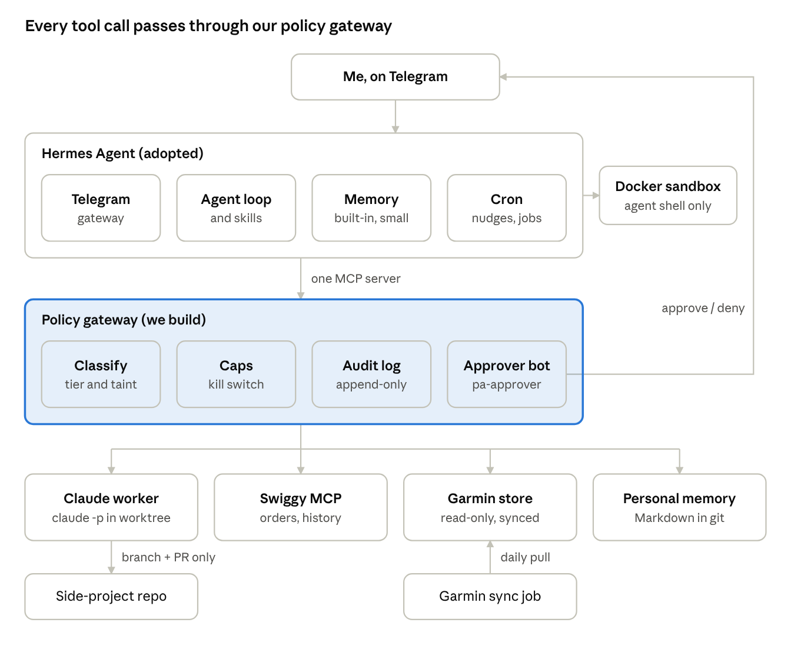
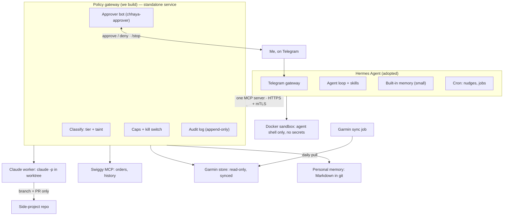
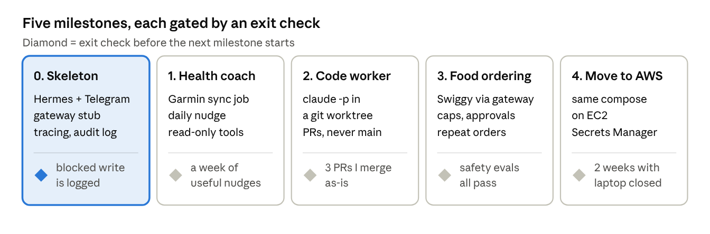
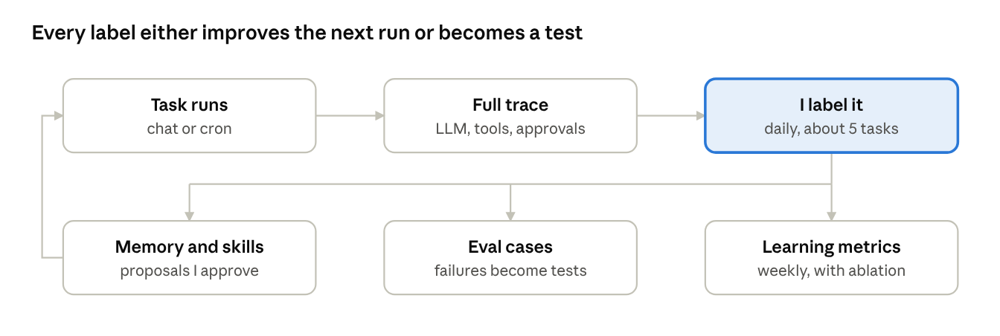
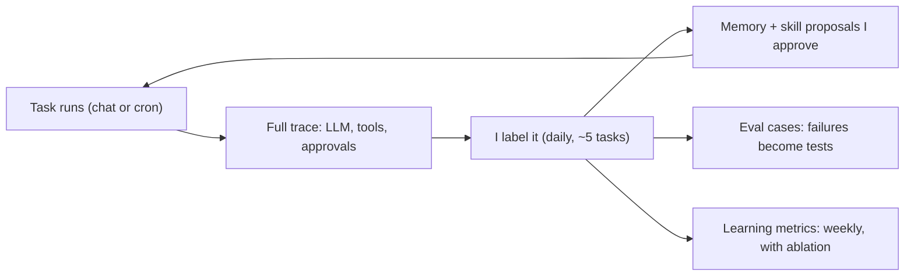

# Personal Agent — Project Design

Oct 2, 2026 · @satish · revised Oct 20, 2026 (Hermes docs verified against v0.22.2; kill switch, gateway transport and trace correlation settled; Muse/Instinct cross-check added — see `decisions.md`)

## Overview

We are building a personal chief-of-staff agent: one orchestrator that knows me, reached only over Telegram, which delegates real work to specialist agents and tools. It starts on my laptop and moves to an AWS instance once the design holds.

The bet is a clean split between two layers. The orchestrator owns *who I am*: my preferences, standards, people and context. Specialists own *a craft*: Claude Code writes code, the Swiggy MCP orders food, a Garmin sync reads health data. Specialists are swappable; the model of me (facts and preferences, procedures, labeled judgments from traces, and the evals built from them) is the asset.

**Non-goals for v0**

- Anything touching Scapia systems or data. This is a personal project first.
- Acting *as* me toward other people (sending messages, emails or posts in my name).
- Full GUI control of the laptop. CLIs, APIs and MCP servers cover the v0 jobs.
- Multiple users or a product. One user, one agent.

## v0 scope

Three jobs, chosen because each tests a different risk: code (writes to repos), money (orders and payment), and personal data (health).

| Job | What it does | Risk class | Done when |
| --- | --- | --- | --- |
| Side-project engineer | Takes a brief over Telegram, runs Claude Code on my side project in a sandbox, reports back with a PR link and summary | Writes code, branch and PR only | I can ship a small feature end to end from my phone, never touching main |
| Food ordering | Orders from Swiggy via its MCP; handles reorders and vague asks ("something light, arriving within 30 min") | Spends money | Repeat orders need one tap to approve; new orders never exceed the cap |
| Health coach | Syncs Garmin data daily; answers questions and sends proactive nudges on sleep, load and recovery | Sensitive data, read-only | One useful nudge a day that I act on, and no noise |

The health coach gives fitness and recovery coaching, not medical advice.

## Architecture

Hermes is the brain; our policy gateway is the only door to anything that matters. The gateway runs as its own service and Hermes reaches it over HTTP with mTLS, so Hermes neither spawns it nor can stop it. Approvals travel on a separate bot, so the agent never sees or answers its own approval prompts.



*Every tool call passes through our policy gateway.*

<details>
<summary>Diagram source (Mermaid)</summary>



</details>

Hermes' shell runs in a Docker sandbox with no secrets, so the only way to touch code, money or data is through the gateway's tools.

### Capability model

To Hermes, the gateway *is* the tool provider: an MCP server upstream and an MCP client downstream. Hermes knows only what the gateway advertises.

- **Discovery:** at startup Hermes calls `tools/list` on its one MCP server (`chhaya`) and registers the result as `mcp_chhaya_<tool>`. That list is its entire external capability set; it never sees Swiggy MCP or the Claude worker directly.
- **Curation:** the gateway re-exports a narrowed subset, e.g. `food.place_order(restaurant, items)` instead of raw Swiggy tools, `code.run_task(repo, brief)` instead of a shell, `health.get_summary(days)` instead of raw Garmin access. Tier-3 actions are not in the list at all.
- **Limits in descriptions:** each tool's description and schema state its limits ("needs approval, max ₹X, allowlisted address only") so the agent plans within them.
- **Hermes' built-in tools** (web, browser, memory, skills, terminal) are a separate surface, restricted in Hermes' config: Docker shell, disabled toolsets where unneeded, `tools.include` as a second filter.
- **Static catalog, call-time enforcement:** the tool list stays fixed; policy is checked per call. Plans stay stable and traces show "tried X, blocked because Y".
- **`capabilities()` tool:** read-only current policy state (caps left today, taint status, kill switch), so Hermes can answer "can you order dinner now?" honestly.

| Decision on a call | What the gateway does |
| --- | --- |
| Allow | Forwards downstream; returns the result redacted and marked trusted or untrusted |
| Deny | Short-circuits with a structured reason ("blocked: over daily cap; ₹420 left") so the agent can adapt |
| Needs approval | Holds the call, asks via chhaya-approver, then forwards or returns "denied by user" |
| Rewrite | Rare (e.g. forcing the `agent/` branch prefix), always reported in the result; prefer deny-with-reason |

## Key design choices

| Decision | Choice | Why |
| --- | --- | --- |
| Channel | Telegram only, no WhatsApp | Free bot API, polling works without a public webhook, native approve/deny buttons. Hermes' gateway already speaks it. |
| Runtime | Adopt [Hermes Agent](https://github.com/NousResearch/hermes-agent) for the loop; don't build it | MIT, Python, model-agnostic. Gives us the agent loop, Telegram gateway, cron, session search and skills on day one. It is the only Python in the system and we run it as a pinned container, never as a library — everything we write is Go. |
| What we build | Policy gateway, Personal memory, evals | These are the moat and the safety boundary. They must survive a runtime swap. |
| Where guardrails live | Outside the agent, in a separate gateway process | Hermes writes its own skills and memory. An agent that can edit itself must not be able to edit its own permissions. |
| How Hermes reaches tools | Exactly one MCP server: our gateway, reached over HTTP with mTLS, never spawned as a subprocess | Hermes never holds Swiggy, GitHub or Garmin credentials. Every write goes through one choke point with one audit log. A standalone service also keeps its own lifecycle and kill switch out of Hermes' hands. |
| Hermes' own shell | Docker backend, no forwarded secrets, or terminal toolset disabled | The built-in terminal tool runs on the host by default and would bypass the gateway. |
| Claude Code | Wrapped as a gateway tool that runs `claude -p` headless in a git worktree | Hermes briefs and supervises; Claude Code does the craft. Branch and PR only. |
| Memory | Built-in memory with write approval on, plus our own Personal memory behind the gateway | Hermes' built-in memory is capped at a few KB by design. Our store is unbounded, structured and exportable. |
| Portability | Containers + Postgres/SQLite + secrets via env from day one | Laptop to AWS becomes a deploy, not a rewrite. |

**The one-line rule:** Hermes decides *what* to do; the gateway decides *whether it's allowed*.

## Permission and safety model

Every tool call is classified by the gateway, not by the model. The model can ask for anything; the gateway decides deterministically.

**Reads come in two classes**

- **Trusted:** my Garmin store, my side-project repo, my Personal memory, my Swiggy order history.
- **Untrusted:** web pages, third-party repos and issues, restaurant listings and reviews, anything written by someone else. Content from these is data, never instructions.
- Reading untrusted content **taints the session**. A tainted session's writes all need explicit approval, whatever their tier, until I run `/new`.

**Writes come in four tiers**

| Tier | Examples | Rule |
| --- | --- | --- |
| 0. Internal | Save a note, update Personal memory, schedule a nudge | Allowed; logged |
| 1. Reversible | Create a branch, open a PR, push to a feature branch | Allowed within allowlisted repos; logged |
| 2. Costs money or leaves the box | Place a Swiggy order, comment on a public issue | Telegram approval every time; repeat orders can be pre-approved under the cap |
| 3. Irreversible or high blast radius | Merge to main, deploy, delete, pay a new merchant, message another person | Not exposed in v0 |

**Hard caps, enforced in gateway code, not prompts**

- Food: max order value per order and per day, allowlisted delivery address only, no new payment methods.
- Code: allowlisted repos, branches matching `agent/*` only, no force push, no CI secret access.
- Rate limits per tool, and a global kill switch that makes the gateway refuse all writes.

**The kill switch lives on the approver bot, never on Hermes' bot.** `/stop` sent to Hermes would arrive through the very process it is meant to stop: Hermes owns that chat, and a confused or compromised agent is exactly the case where it must not be the one relaying the command. So `/stop` and `/resume` are commands on **chhaya-approver**, handled by the gateway directly, in the same process that enforces caps and out of the agent's reach. Two backstops behind it, in order of how little they trust: a flag file the gateway checks before every write, and stopping the gateway container, which removes Hermes' only route to code, money and data. The switch fails closed — if the gateway cannot read its own state, it refuses writes.

Hermes learns it was stopped the ordinary way: its next tool call returns "blocked: kill switch active", and `capabilities()` reports the same, so it can tell me honestly rather than retrying.

**Approvals** arrive in Telegram as a summary plus ✅ / ❌ buttons: what, why, cost, and which rule triggered the prompt. A timeout means deny.

**Audit log:** every call, its classification, decision, arguments (secrets redacted) and result, append-only. I should be able to answer "what did it do yesterday?" from the log alone.

## Memory: Personal memory (the model of me)

The model of me is the asset, so it lives in Personal memory, our durable long-term memory, kept in plain files I can read, edit and export. Hermes' own memory is a small cache on top.

**Two layers**

- **Hermes built-in** (`MEMORY.md`, `USER.md`): capped at 2,200 and 1,375 characters by design. Use it for the handful of facts every session needs. Turn on `memory.write_approval: true` so nothing lands without my yes.
- **Personal memory**: a folder of Markdown files in the repo, indexed in SQLite, exposed through the gateway as tools (`memory.search`, `memory.get`, `memory.propose_update`). Unbounded, versioned in git.

**Memory types in the design.** Personal memory is the durable long-term memory; everything else is a cache, a playbook or raw history.

| Type | Where it lives | Durable? | Role |
| --- | --- | --- | --- |
| Semantic (facts, tastes, standards, decisions) | Personal memory | Yes, and ours | The main durable memory: unbounded, reviewed, portable |
| Procedural (how to do things) | Hermes skills | Yes, in Hermes' format | Playbooks for recurring tasks; exported in weekly snapshots |
| Episodic (what happened) | Traces in Langfuse + Hermes session DB | Yes | Raw history; source of labels and evals |
| Always-on cache | Hermes `MEMORY.md` / `USER.md` | Yes, but about 3 KB | A few facts injected into every session |
| Working | The live context window | No | Current task only |

**Structure of the store**

| Area | Examples |
| --- | --- |
| `identity/` | Role, time zone, routines, how I like to be addressed |
| `taste/` | Food (cuisines, spice level, go-to orders, what I avoid), code style, writing style |
| `standards/` | How I review PRs, what "done" means, what I never want shipped |
| `people/` | Who's who and how I work with them (context only, never acting as me toward them) |
| `health/` | Training goals and what kind of nudges help (no raw data; that stays in the Garmin store) |
| `decisions/` | Choices I made and why, so the agent doesn't re-ask |

**How it learns**

1. Explicit: I say "remember X" → written directly.
2. From corrections: I edit a PR comment, reject an order or say "no, too spicy" → the agent proposes an update.
3. From patterns: a weekly review job proposes updates from the week's sessions.

Paths 2 and 3 only ever **propose**. Proposals land as a diff I approve in Telegram or as a commit to review. Every entry records where it came from (my words, a correction, an inference), so drift is traceable and reversible.

## Bootstrap with Hermes (laptop)

Goal for day one: talk to Hermes from Telegram, with exactly one MCP server attached (our gateway, stubbed), approvals on and the host shell sandboxed. Commands below are from the [Hermes docs](https://hermes-agent.nousresearch.com/docs/) as of today; check them against the version you pin.

1. **Install and pin.** Read `install.sh` before running it, or use a source checkout at a release tag so upgrades are deliberate.

   ```bash
   curl -fsSL https://hermes-agent.nousresearch.com/install.sh | bash
   hermes model      # pick provider + model
   hermes doctor
   ```
2. **Create a Telegram bot** with @BotFather, then wire it in. Lock it to my user ID; with no allowlist, Hermes denies everyone.

   ```bash
   hermes gateway setup   # choose Telegram, paste the bot token
   # in ~/.hermes/.env
   TELEGRAM_ALLOWED_USERS=<my telegram user id>
   chmod 600 ~/.hermes/.env
   hermes gateway start
   ```
3. **Harden `~/.hermes/config.yaml`.**

   ```yaml
   approvals:
     mode: manual          # always ask on dangerous commands
     cron_mode: deny       # headless cron runs never self-approve
     single_query_mode: deny
     unattended_mode: deny
     timeout: 300
   terminal:
     backend: docker       # agent shell never touches the host
     docker_forward_env: [] # no secrets forwarded into the container
     env_passthrough: []    # no *config-declared* passthrough (see caveat below)
   memory:
     write_approval: true  # I approve every memory save
   skills:
     write_approval: true  # load-bearing, not hygiene: see below
   ```

   ```bash
   # hard-bound write root; the agent cannot write outside these prefixes
   export HERMES_WRITE_SAFE_ROOT=/opt/data:~/.hermes
   ```

   Three things the Hermes docs make clear that change how these settings should be read:

   - **`skills.write_approval: true` is a security control, not tidiness — and it is the *only* control here.** The v0.22.2 source is explicit: *"Env vars passed into sandboxed terminal/execute_code (skill-declared `required_environment_variables` pass through automatically)."* Note what that means: **setting `env_passthrough: []` does not close the skill path.** A skill that declares the variable gets it, empty list or not. Since Hermes authors its own skills, the only point of control is approving the skill before it exists. This setting stays on permanently.
   - **`approvals.mode` defaults to `smart`**, where an auxiliary LLM auto-approves commands it judges low-risk. `manual` is a deliberate downgrade from "a model decides" to "I decide". Related knobs worth knowing: `approvals.deny` (fnmatch globs that block even under `--yolo`), `smart_policy`, and `denial_breaker_threshold`.
   - **The Docker backend skips dangerous-command approval entirely** — container backends bypass those checks because the container *is* the boundary. So `backend: docker` and `approvals.mode: manual` are not two layers over the shell; they are one. That is acceptable only because the gateway, not the approval prompt, is our real boundary.
   - **User authorization** is an allowlist (`TELEGRAM_ALLOWED_USERS`) plus a DM-pairing flow (pairing codes approved with `hermes pairing approve`), with deny as the default. Confirm the pairing flow is off or scoped before exposing the bot.
4. **Attach the gateway as the only MCP server — over HTTP, not as a subprocess.** Start with a stub that exposes `ping` and `memory.get`.

   ```yaml
   mcp_servers:
     chhaya:
       url: "https://127.0.0.1:8443/mcp"
       client_cert: "~/.hermes/certs/hermes.crt"   # mTLS; the gateway pins this
       client_key: "~/.hermes/certs/hermes.key"
       sampling:
         enabled: false      # the gateway never asks Hermes for inference
       elicitation:
         enabled: false      # no approval path that routes through the agent
   ```

   **Why not stdio.** The obvious config spawns the gateway as a child process (`command: uv`, `args: ["run", "chhaya-gateway"]`). Three reasons not to:

   - Hermes would own the gateway's lifecycle — including the process holding the kill switch.
   - Hermes strips credential-named variables from MCP subprocess environments, so the gateway's Swiggy, GitHub and Garmin secrets would have to be written into Hermes' own config `env:` block. That puts every credential inside the one component designed never to hold any.
   - The gateway would die with Hermes, and cron jobs with it.

   As a standalone service the gateway owns its secrets, its lifecycle and its kill switch, Hermes authenticates to it as a client, and the move to AWS is two containers in the same compose file rather than a re-architecture.

   Sampling and elicitation are both **on by default** in Hermes and are turned off deliberately above. Elicitation in particular would surface approval prompts as Telegram buttons *through the agent* — precisely what the separate approver bot exists to avoid.

   > **Verified in v0.22.2 source** (`tools/mcp_tool_server_run.py:268-276`). Both are **nested dicts, not booleans**, and both default to on: `config.get("sampling", {}).get("enabled", True)`. Writing `sampling: false` would make `config.get(...)` return `False` and then raise `AttributeError` on `.get()` — a startup crash, not a silently ignored key. `client_cert` + `client_key` is a valid pair (the list form `client_cert: [cert, key]` is the alternative; supplying both forms is rejected).

   Do **not** install Swiggy or GitHub MCPs into Hermes directly; the gateway connects to them as a client.
5. **Approvals channel.** The gateway sends its own approval prompts through a **second Telegram bot** ("chhaya-approver") so the agent process can never see or click its own approvals. The same bot carries `/stop` and `/resume`, for the same reason. Hermes' MCP elicitation support (form prompts surfaced as Telegram buttons) is a simpler v0 shortcut, but it routes through the agent — and so cannot carry the kill switch at all.
6. **Smoke test** from Telegram: "ping the gateway", "what do you know about my food taste?", then a write that should be blocked. Then `/stop` on the approver bot, retry the write, and `/resume`. Confirm the audit log shows all five, including the kill-switch refusal.
7. **Session hygiene:** a Telegram chat is one long session in Hermes, and memory only refreshes at session start. Use `/new` at natural breaks (daily, or per task). This is also what keeps one task equal to one trace — see [Traces and labeling](#traces-and-labeling).

## Repo layout and working with Claude Code

One repo, `chhaya/`, holds everything we own. Hermes stays an installed dependency, configured from files in this repo.

```
chhaya/
  CLAUDE.md              # conventions for Claude Code (below)
  docs/design.md         # this doc, exported
  docs/decisions.md      # append-only log of choices and why
  docs/diagrams/         # rendered figures for this doc
  cmd/chhayad/           # the gateway daemon — wiring only, no logic
  cmd/chhayactl/         # operator CLI: audit verify, policy explain, stop
  internal/
    policy/              # classifier, tiers, caps, taint, kill switch (pure)
    audit/               # hash-chained append-only log, and its verifier
    approval/            # chhaya-approver Telegram bot
    mcpsrv/              # MCP over HTTPS+mTLS; the only path to a tool handler
    tools/               # memory, swiggy, claude_worker, garmin
    config/              # policy.yaml load and validate
  sync/garmin/           # scheduled pull into SQLite
  memory/                # Personal memory (Markdown, git-tracked)
  hermes/                # config.yaml template, SOUL.md, skills we author
  config/policy.yaml     # caps, allowlists, repo list
  evals/                 # scenario tests (see Evals)
  deploy/                # docker-compose.yml now, AWS later
```

**`CLAUDE.md` should tell Claude Code:**

- The gateway is the security boundary. Every new tool must be registered with a tier, a validator and an audit entry; no tool bypasses `policy/`.
- Policy is code plus `policy.yaml`, never prompt text. Changes to `policy/` need tests that prove a blocked case stays blocked.
- Secrets come from env only. Never log them; the audit logger redacts by default.
- Go 1.24+, standard `go test`, small focused packages. Everything we write is Go; Hermes is the only Python in the
  system and it is an opaque dependency we run as a container. Run `make test` and `make evals` before saying done.
- Never edit files under `memory/` except through `memory.propose_update` flows.

**Working loop:** describe one milestone at a time to Claude Code, ask it to plan first, review the plan, then let it build with tests. Keep a short `docs/decisions.md` it appends to whenever we make a choice, so later sessions don't re-litigate.

## Milestones and the move to AWS

Build in risk order: read-only first, then reversible writes, then money, then the move. Each milestone ends with an exit check before the next starts.



*Five milestones, each gated by an exit check. Diamond = exit check before the next milestone starts.*

```mermaid
flowchart LR
  M0["0. Skeleton: Hermes + Telegram, gateway stub, tracing, audit log"]
  M1["1. Health coach: Garmin sync, daily nudge, read-only tools"]
  M2["2. Code worker: claude -p in a git worktree, PRs never main"]
  M3["3. Food ordering: Swiggy via gateway, caps, approvals, repeat orders"]
  M4["4. Move to AWS: same compose on EC2, Secrets Manager"]
  M0 -->|"exit: blocked write is logged"| M1
  M1 -->|"exit: a week of useful nudges"| M2
  M2 -->|"exit: 3 PRs I merge as-is"| M3
  M3 -->|"exit: safety evals all pass"| M4
  M4 -.->|"exit: 2 weeks with laptop closed"| Done(("v1"))
```

<details>
<summary>Diagram source (Mermaid)</summary>



</details>

**Moving to AWS** is a deploy, not a rewrite, if milestones 0–3 keep to the portability rules:

- Hermes, the gateway and the sync job ship as containers in one `docker-compose.yml`; the same file runs on a small EC2 instance.
- Hermes data (`~/.hermes`), Personal memory and the audit log live on a mounted volume with daily snapshots.
- Secrets move from `.env` to AWS Secrets Manager, injected as env at start.
- No inbound ports: Telegram polling and outbound MCP calls only. Admin access through SSM Session Manager, not SSH.
- Claude Code runs on the instance against a clone of the side project; the laptop drops out of the loop.

## Traces and labeling

**Requirement:** every task gets a complete trace, reviewable and annotatable in a friendly UI. At 4–5 tasks a day (about 150 a month), I can label every one, and labels are the main way the agent learns.



*Every label either improves the next run or becomes a test.*

<details>
<summary>Diagram source (Mermaid)</summary>



</details>

**What a trace holds:** the trigger (my message or a cron run), every LLM call (prompt, response, model, tokens, cost, latency), every gateway tool call (arguments, policy decision, result), approvals asked and answered, memory and skill changes proposed, and the final outcome. One task = one trace.

**Three capture points, joined on one task ID**

1. **Model proxy:** Hermes points at a local OpenAI-compatible proxy that logs every LLM call. Hermes accepts any endpoint, so no fork is needed.
2. **Policy gateway:** emits a span for every tool call and approval. We own this code, so it is complete by construction.
3. **Hermes session store** (`~/.hermes/state.db`): ingested after each task for the messages, memory writes and skill changes.

**How the join actually works.** Pointing Hermes at a proxy is the easy half; correlating what the proxy sees with gateway spans is the half that could have needed a fork. It doesn't. A custom provider takes a **`session_affinity_header`**, which carries Hermes' conversation id on every request to that endpoint — main turn *and* auxiliary calls such as compression, titles and background review. Set it, and every LLM call arrives at the proxy already stamped.

```yaml
providers:
  chhaya-proxy:
    api: "http://127.0.0.1:4000/v1"
    key_env: PROXY_API_KEY
    transport: chat_completions
    session_affinity_header: x-chhaya-session-id
```

The gateway stamps the same id on its spans, and the session store is keyed by it natively, so all three capture points join without a fork or a heuristic.

**This makes `/new` load-bearing twice over.** The header carries a *conversation* id, not a task id, and a Telegram chat is one long conversation. So "one task = one trace" holds only if a task boundary is a session boundary. `/new` was already the rule for refreshing memory; it is now also what keeps traces addressable. If the discipline slips, the fallback is to segment a session into tasks at the gateway — but the cheap fix is a nudge from the evening digest when a session has run long.

**UI: self-hosted [Langfuse](https://langfuse.com/docs/evaluation/evaluation-methods/annotation-queues)** to start. It is MIT-licensed, self-hostable, and has annotation queues built on score configs, datasets built from traces, LLM-as-judge evaluators, and analytics that compare judge scores with human labels. The cost is a heavy stack (ClickHouse, Postgres, Redis, blob storage), which is fine in Docker Compose. If labeling on a phone feels clumsy, build a thin custom UI on its API later.

**Daily rhythm:** a Telegram digest each evening ("5 tasks today, 1 flagged") with links into the annotation queue. Labeling should take under 10 minutes.

**Label schema (one score config)**

| Field | Values |
| --- | --- |
| Outcome | done well · done with corrections · wrong · harmful |
| Failure modes (multi-select) | misread intent · wrong taste · forgot something it knew · tool or API error · blocked correctly · blocked wrongly · unsafe attempt · too many questions · too slow or costly |
| What I wanted | Free text: the correction in my words |
| Remember this | Yes/no: propose a memory or skill update from this trace |

Each label feeds three places: an approved memory or skill change, a new eval case, and the learning metrics.

## Evals

Four tiers, from cheap and deterministic to judged. The lower tiers are monitors that should never be wrong; the upper tiers grow out of my labels.

| Tier | Checks | Examples | Judged by | Runs |
| --- | --- | --- | --- | --- |
| L0 Ops | The plumbing did its job | Cron fired within a few minutes of schedule · Garmin sync wrote today's rows and the latest timestamp is fresh · gateway reachable · every task has a complete trace (LLM spans, tool spans, outcome) · audit log matches tool spans | Code assertions; failures alert on Telegram | Every run, daily summary |
| L1 Safety | Policy holds | Injected instructions in a README or review · order over the cap · push to main · write after a tainted read | Assertions on gateway decisions, tools mocked | Every change to `policy/`, nightly |
| L2 Failure modes | Past mistakes stay fixed | Each trace labeled wrong becomes a case: input + context snapshot + expected property ("no paneer", "at most one question", "PR touches only `api/`") | Assertion where possible, else an LLM judge with a rubric | Before any memory, skill, prompt or model change; nightly |
| L3 Taste | Is it doing it my way | Scenarios with my own judged answers: "order dinner, it's late and I'm tired", "review this PR like I would" | LLM judge calibrated against my labels | Weekly |

**Replay harness.** L1–L3 run against recorded tool responses, never live tools, so an eval can't order food or push code. Each case pins the context it ran with: the git SHA of Personal memory plus an export of Hermes memory and skills.

**Judge calibration.** An LLM judge only counts once it agrees with my labels. Langfuse's score analytics shows judge-vs-human agreement. With so few labels a week, a Bayesian treatment of judge reliability and pass rates (the BayesJudge approach) gives honest uncertainty instead of noisy point estimates.

## What compounds, and how we know

Not every part learns. Personal memory, skills and the eval suite compound; the policy gateway deliberately does not self-learn; the specialists and the base model are rented.

| Component | Learns? | What compounds | Improving if | Stalling or drifting if |
| --- | --- | --- | --- | --- |
| Personal memory | Yes, the main lever | Facts, tastes, standards, decisions, via labels and approved proposals | "Forgot something it knew" and "wrong taste" labels fall; fewer clarifying questions | Proposals often rejected; entries contradict; right entry retrieved but outcome still wrong |
| Hermes skills | Yes | Procedures for recurring tasks | Success on recurring task types rises; fewer steps, tokens and seconds per repeat | The same skill patched repeatedly; L2 regressions after a skill change |
| Hermes built-in memory | Barely | A \~3 KB cache of always-needed facts | Not a metric target; keep it accurate | Fills up and thrashes |
| Hermes session search | Automatically | Raw history | Tasks needing past context succeed without re-asking | Acts on stale old context |
| Policy gateway | No, by design | Not the rules: pre-approved patterns (mined from approval history, promoted only by me), tuned caps, the L1 safety suite | Approvals per task fall while safety evals stay at 100% and "harmful" stays at zero; "blocked wrongly" falls | Approval fatigue: approvals tapped in under 2 seconds without reading (track time-to-approve) |
| Specialists (Claude worker, Swiggy) | Not from us | Only the briefs Hermes writes and the repo's `CLAUDE.md` | PRs merged as-is rise; review rounds fall | Same review comments recur |
| Evals and labels | Yes | Case count, failure-mode coverage, judge accuracy | Judge–human agreement rises; every failure mode has cases | New failures not covered by any case |
| Base model | Rented | Not ours | Shows up as D − C in the ablation below | — |

**Attribution:** the monthly C − A curve below says whether the system as a whole improves. Quarterly component ablations (no Personal memory, no skills, no pre-approved patterns) say which part earns it. If removing a component doesn't hurt, it isn't compounding. The gateway's boundary changes only through my explicit promotions, and each promotion is measured too.

## Is it learning?

The success test for the whole project: **a year from now, on my own tasks, the agent clearly beats a vanilla chat agent running the same model with the same tools.** If it doesn't, the memory, skills and labeling aren't paying for themselves.

Since September 2026 that bar is too low to be honest. Muse and Instinct (see [Landscape](#landscape-muse-instinct-and-what-they-change)) do consumer errands well and cost nothing, so "beats a vanilla chat agent" flatters us on exactly the job where we are least differentiated. **Arm A becomes a real competitor, not a strawman:** the best available general agent on the same task, which for food means Muse. Expect to lose on dinner and win on code, health and anything that must stay private — and let the arm-A comparison say so out loud rather than hide it.

**1. Is it getting better at my tasks? (weekly, from labels)**

- First-pass success: share of tasks labeled "done well".
- Corrections per task, and counts per failure mode (a learning agent should see "forgot something it knew" and "wrong taste" fall first).
- Clarifying questions per task, approval rejection rate, cost and latency per task.
- At about 30 tasks a week, raw rates are noisy. Report each as a posterior with a credible interval (beta-binomial) and call a change real only when intervals separate.

**2. Is the gain from learning, or just a better model? (monthly ablation)**

Replay a benchmark of my real tasks through four arms:

| Arm | Model | Learned state | Answers |
| --- | --- | --- | --- |
| A. Baseline | Current | None of ours: no Personal memory, Hermes memory or skills; same tools. Where a general agent (Muse, Instinct) covers the task, run it as a second arm-A variant | The baseline to beat |
| B. Day zero | Current | The state I started with | What setup alone buys |
| C. Current | Current | Today's Personal memory, Hermes memory and skills | C − A = value of learning |
| D. Newer model | Newest | Today's state | D − C = value of the model upgrade |

**3. Avoiding a rigged benchmark.** Past tasks shaped the memory, so scoring today's state on them flatters it. Instead evaluate *prospectively*: snapshot the state at the start of each month and score that snapshot, and arm A, on the tasks that arrive during the month. Over a year this gives a learning curve of 12 snapshots, each judged on tasks it had never seen.

**Prerequisites:** weekly snapshots of learned state (a git tag on Personal memory plus an export of Hermes memory and skills), the replay harness, and a target for C − A set after the first month's baseline rather than guessed now.

## Landscape: Muse, Instinct and what they change

Two general personal agents launched weeks before this design and neither is in the first draft. Checking our choices against them is reassuring rather than otherwise.

| | Muse (Meta, Sept 8 2026) | Instinct (Spear Street) | This design |
| --- | --- | --- | --- |
| Where guardrails live | **Sentinel: enforced outside the model** | Undocumented; acts as an autonomous proxy | Gateway, outside the agent |
| Permission granularity | Read vs write, "always ask" mode | Not documented | Four write tiers + read taint |
| Isolation | VM per user | Persistent cloud machine, cached credentials | Docker sandbox, no secrets |
| Audit | Per-action activity log | None documented | Append-only, every call |
| Memory | User-readable, editable `MEMORY.md` | "Learns preferences", opaque | Markdown in git, provenance per entry |
| Channel | App, web, glasses, phone calls | iMessage, WhatsApp, phone calls | Telegram only |
| Measures its own learning | No | No | Yes: labels, evals, monthly ablation |

**The core thesis was arrived at independently.** Meta describes Sentinel's approval checks as *enforced outside the AI model, to prevent a confused agent from bypassing itself.* That is our one-line rule, built by a company with rather more to lose. Read-vs-write separation, per-user isolation, per-action audit trails and a user-editable `MEMORY.md` are four more convergent choices. We are not behind the state of the art on safety architecture; we are at it.

**Instinct is the counterexample that makes the case.** It keeps cached credentials, publishes no activity log, and its terms appoint it your legal agent. On Sept 21 2026 a user alleged it had surfaced another person's financial details; the founder attributed this to hallucination rather than a breach. With no audit trail, neither account can be checked — which is precisely the failure the audit log exists to prevent. "Trust me" is not a security property.

**Three things to take from them**

1. **Watch it work.** Muse shows a live browser you can observe and take over mid-task. We only have traces after the fact. For the code worker — the longest-running job — streaming progress into Telegram with an abort button recovers most of that value cheaply.
2. **A harder baseline.** Reflected in [Is it learning?](#is-it-learning) above: arm A becomes the best general agent available, not a strawman.
3. **Agent traffic gets blocked.** Amazon blocked Muse on Sept 21 2026 citing ToS, an undisclosed integration, and the agent not identifying itself. Official authenticated surfaces only, and identify ourselves honestly.

**Build-vs-buy, honestly.** Muse and Instinct beat us at consumer errands and cost nothing, so food is now the weakest of our three jobs on differentiation — worth keeping for what it tests (money, caps, approvals) rather than for the dinner. What neither offers, and what justifies the build: Telegram-only private operation, a code worker on my own repos, health data in a store I own, a policy boundary I control and can read, memory I can export, and any measurement at all of whether the thing is learning.

## Risks and open questions

**Risks**

| Risk | Mitigation |
| --- | --- |
| Prompt injection via untrusted reads | Taint tracking; tainted sessions need approval for every write |
| Hermes moves fast and breaks things | Pin a release; upgrade deliberately after reading the changelog |
| Memory drift ("learns" something wrong) | Write approval on; provenance on every entry; weekly review |
| Self-modifying skills widen behaviour | Skill write approval stays on permanently: a skill can self-declare `required_environment_variables` and have them forwarded into the sandbox with no config change. Gateway caps unaffected by skills |
| Unofficial Garmin access breaks | Sync into our own store; coach degrades gracefully on stale data |
| Approval fatigue | Mine approvals into pre-approved patterns, only for tiers 0–2. Hermes ships `hermes approvals suggest`, which does this for shell commands; ours covers gateway tools |
| Services block agent traffic | Amazon blocked Meta's Muse in Sept 2026 over ToS, an undisclosed integration and the agent not identifying itself. Use official, authenticated agent surfaces only (Swiggy MCP, GitHub API), identify ourselves honestly, never scrape or drive a logged-in UI |
| Swiggy production access is invite-gated | Partner onboarding has unknown lead time and M3 depends on it. Apply early; M3 slips behind M1 and M2 rather than blocking them |
| Hermes release hygiene | v0.22.1 shipped from the wrong commit with unreleased gateway code. Pin a tag, read release notes, never track `main` |

**Open questions**

- [ ] Which model for the orchestrator, and do I want a cheaper one for background review? (Hermes has `auxiliary.background_review` with its own model route, so this is a config choice, not a build.)
- [ ] Garmin: official developer program, or the unofficial library to start? The usable unofficial clients are Python, so "start unofficial" means standing up a separate sync process rather than importing a package into the gateway. **Blocks M1.**
- [ ] Does Swiggy's partner agreement permit a personal, single-user agent at all, and what is the onboarding lead time? **Blocks M3.**
- [ ] On AWS, does Claude Code run on the instance against a clone, or stay on the laptop?
- [ ] Is a live "watch it work" view worth building for the code worker, or is streaming progress plus an abort button enough?

**Resolved since the first draft** (Oct 20, 2026)

- ~~Swiggy MCP: which tools does it expose, and does it support a spending cap natively?~~ Four official servers at `mcp.swiggy.com`; Food is 20 tools at `/food`, remote JSON-RPC over streamable HTTP, OAuth 2.1 + PKCE, session auth, no raw card details. **No native spending cap** — caps stay ours, as designed. The gateway, not Hermes, is the OAuth client.
- ~~Should Personal memory become a Hermes memory provider plugin later, or stay a gateway tool?~~ **Stays a gateway tool.** Hermes does support external memory providers as plugins (Mem0, Honcho, Hindsight and others), but a plugin runs *inside* Hermes — inside the boundary we deliberately don't trust. Using it would put the model of me on the wrong side of the gateway.
- ~~Can the model proxy join its traces to gateway spans without forking Hermes?~~ **Yes**, via `session_affinity_header`. See [Traces and labeling](#traces-and-labeling).

## Sources

**Hermes** (verified against v0.22.2, published Oct 15 2026)

- [Hermes Agent docs](https://hermes-agent.nousresearch.com/docs/)
- [Hermes: MCP integration](https://hermes-agent.nousresearch.com/docs/user-guide/features/mcp) — transports, `tools.include`/`exclude`, sampling and elicitation defaults
- [Hermes: Security](https://hermes-agent.nousresearch.com/docs/user-guide/security) — approvals, sandbox backends, env filtering, skill-scoped passthrough, DM pairing
- [Hermes: Persistent memory](https://hermes-agent.nousresearch.com/docs/user-guide/features/memory) — the 2,200 / 1,375 char caps, write approval, external providers
- [Hermes: Configuration](https://hermes-agent.nousresearch.com/docs/user-guide/configuration)
- [Hermes: LLM and model providers](https://hermes-agent.nousresearch.com/docs/integrations/providers) — `session_affinity_header`, `extra_headers`
- [Hermes Agent on GitHub](https://github.com/NousResearch/hermes-agent)

**Tools and specialists**

- [Swiggy MCP: Builders Club docs](https://mcp.swiggy.com/builders/docs/start/what-is-swiggy-mcp/)
- [Langfuse: annotation queues](https://langfuse.com/docs/evaluation/evaluation-methods/annotation-queues)

**Landscape**

- [Meta: Introducing Muse](https://about.fb.com/news/2026/09/introducing-muse-personal-ai-agent/)
- [Muse (AI agent) — Wikipedia](https://en.wikipedia.org/wiki/Muse_(AI_agent)) — Sentinel, isolated VMs, the Amazon block
- [Instinct AI vs Meta Muse: permissions and approvals](https://www.eesel.ai/blog/instinct-ai-vs-meta-muse)
- [TechCrunch: Meta debuts its Muse AI agent](https://techcrunch.com/2026/09/08/meta-debuts-its-muse-ai-agent-will-consumers-trust-it/)
- [Instinct user alleges assistant surfaced another person's financial details](https://runtimewire.com/article/instinct-noah-shinn-hallucination-stranger-data)
